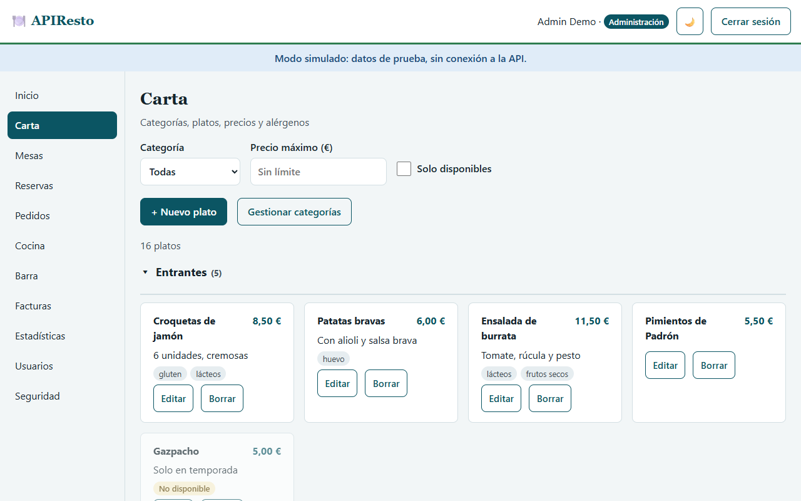
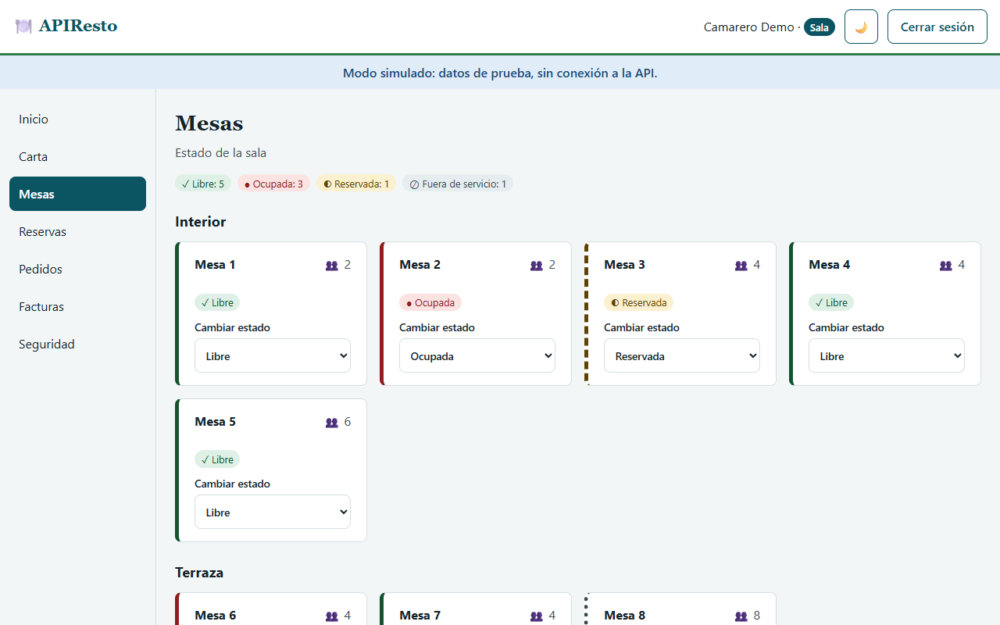
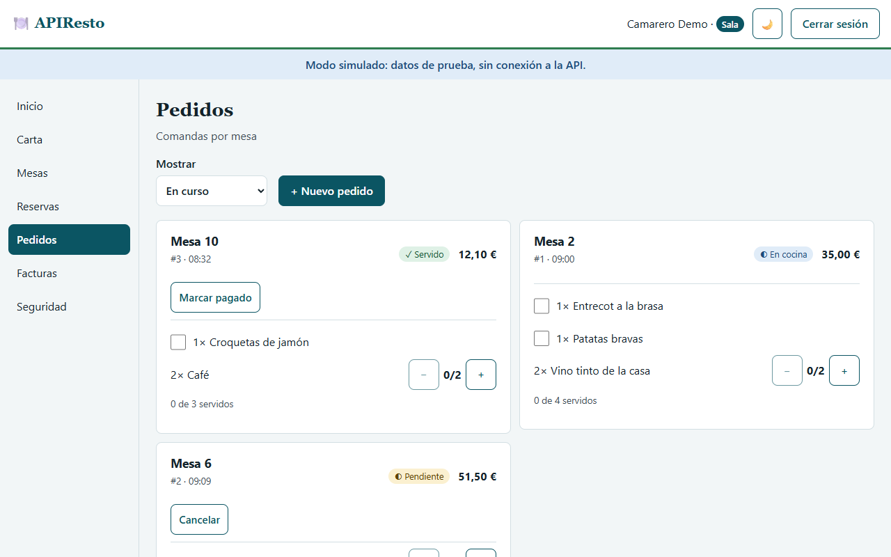
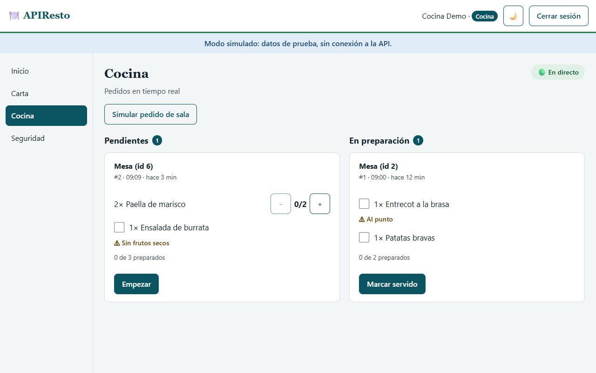
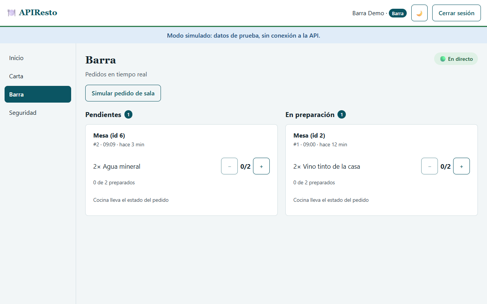
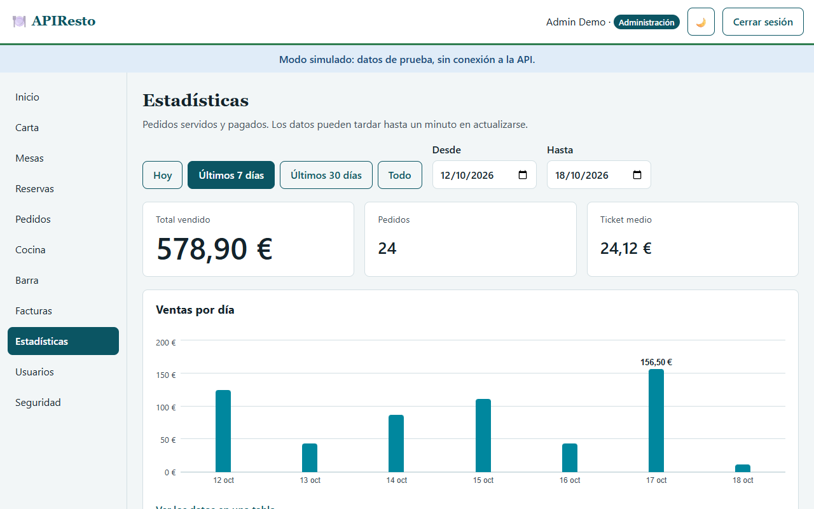
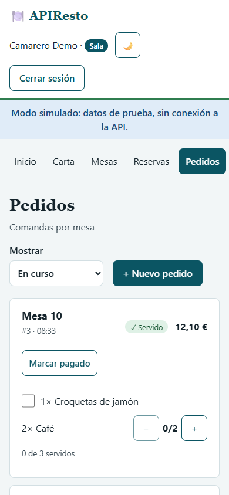

# 🍽️ APIResto

**Gestión de un restaurante en una sola web: carta, mesas, reservas, pedidos, cocina, barra, facturas y estadísticas, con una vista para cada rol.**

*Restaurant management in a single web app: menu, tables, bookings, orders, kitchen, bar, invoices and sales stats, with a view for each role.*

**[🇪🇸 Castellano](#castellano) · [🇬🇧 English](#english) · [📸 Capturas / Screenshots](#capturas--screenshots) · [🛠️ Documentación técnica / Technical docs](#documentación-técnica--technical-docs)**

> 🌐 **App:** [apiresto-f5.vercel.app](https://apiresto-f5.vercel.app) · **API:** [restoapi-47sp.onrender.com](https://restoapi-47sp.onrender.com) ([Swagger](https://restoapi-47sp.onrender.com/docs)) · **Frontend:** [IA-P1-BCN/APIResto_Frontend](https://github.com/IA-P1-BCN/APIResto_Frontend) · **Backend:** [IA-P1-BCN/APIResto_Backend](https://github.com/IA-P1-BCN/APIResto_Backend)


## Castellano

### Qué es

APIResto es un proyecto del bootcamp de IA de Factoría F5 (Barcelona): una API REST con FastAPI y PostgreSQL y una web en React que la usa. Cada persona del restaurante entra con su rol y ve solo lo que necesita: la sala toma los pedidos, la cocina y la barra los ven llegar al momento, la administración factura y consulta las ventas, y los clientes reservan mesa.

Este repositorio es la **API REST** (FastAPI). La web está en [IA-P1-BCN/APIResto_Frontend](https://github.com/IA-P1-BCN/APIResto_Frontend).

> La API está en el plan gratuito de Render y se duerme cuando nadie la usa: la primera petición puede tardar un minuto en despertarla.

### Equipo

| Rol | Persona | GitHub |
|---|---|---|
| Scrum Master | Rita Pereira | [@arita-pereira](https://github.com/arita-pereira) |
| Product Owner | Levi | [@levifvy](https://github.com/levifvy) |
| Desarrollo | Carla | [@cdecaprio](https://github.com/cdecaprio) |
| Desarrollo | Anna Costa | [@costanna](https://github.com/costanna) |
| Desarrollo | Manon | [@ManonChab](https://github.com/ManonChab) |

### Qué puede hacer cada rol

| Rol | En la web |
|---|---|
| **Administración** | Todo lo de la sala, la cocina y la barra; gestionar la carta y las mesas; facturas y exportación CSV; estadísticas de ventas |
| **Sala** (camarero) | Mesas en tiempo real, reservas, pedidos por mesa (enviar a cocina, servir por unidades, cobrar) y facturas |
| **Cocina** | Pedidos de cocina en directo: empezar, marcar unidades preparadas y servir |
| **Barra** | Lo mismo para bebidas y postres |
| **Cliente** | Ver la carta y reservar mesa (el restaurante le asigna la mesa; hasta 8 personas) |

Para todos: login con email y contraseña o con Google y GitHub, verificación en dos pasos (TOTP) opcional, límite de intentos de login, modo claro y oscuro y uso desde el móvil. El personal invitado crea su contraseña desde un enlace por email. La gestión de usuarios se hace desde la API (Swagger); en la web, la página *Usuarios* aún está en preparación.

### Probar la demo

1. Abre [apiresto-f5.vercel.app](https://apiresto-f5.vercel.app) y pulsa **Probar la demo**.
2. Elige un rol (Administración, Sala, Cocina, Barra o Cliente); la contraseña es `demo1234`.
3. La demo funciona entera en tu navegador, con datos de prueba: no toca la base de datos real. Tus cambios se guardan en ese navegador; *Empezar de cero* los borra.
4. En *Seguridad*, el código de la app de autenticación de la demo es siempre `123456`.

### Arquitectura

| Parte | Tecnología | Dónde |
|---|---|---|
| Web | React 19 + TypeScript + Vite | Vercel |
| API | FastAPI + SQLAlchemy + Alembic (Python 3.12) | Render |
| Base de datos | PostgreSQL | Neon |
| Tiempo real | WebSocket (`/ws/kitchen`) | Render |
| Emails | Brevo | — |

## English

### What it is

APIResto is a project from the Factoría F5 AI bootcamp (Barcelona): a REST API built with FastAPI and PostgreSQL, and a React web app that uses it. Each person in the restaurant signs in with their role and only sees what they need: floor staff take orders, the kitchen and the bar see them arrive instantly, admins invoice and check sales, and customers book a table.

This repository is the **REST API** (FastAPI). The web app lives in [IA-P1-BCN/APIResto_Frontend](https://github.com/IA-P1-BCN/APIResto_Frontend).

> The API runs on Render's free plan and sleeps when nobody uses it: the first request can take about a minute to wake it up.

### Team

| Role | Person | GitHub |
|---|---|---|
| Scrum Master | Rita Pereira | [@arita-pereira](https://github.com/arita-pereira) |
| Product Owner | Levi | [@levifvy](https://github.com/levifvy) |
| Developer | Carla | [@cdecaprio](https://github.com/cdecaprio) |
| Developer | Anna Costa | [@costanna](https://github.com/costanna) |
| Developer | Manon | [@ManonChab](https://github.com/ManonChab) |

### What each role can do

| Role | In the web app |
|---|---|
| **Admin** (*Administración*) | Everything the floor, kitchen and bar can do; manage the menu and the tables; invoices and CSV export; sales stats |
| **Floor staff** (*Sala*) | Live table status, bookings, orders per table (send to the kitchen, serve item by item, charge) and invoices |
| **Kitchen** (*Cocina*) | Live kitchen orders: start, mark units as prepared and serve |
| **Bar** (*Barra*) | The same for drinks and desserts |
| **Customer** (*Cliente*) | Browse the menu and book a table (the restaurant assigns the table; up to 8 people) |

For everyone: sign-in with email and password or with Google and GitHub, optional two-step verification (TOTP), a limit on failed sign-in attempts, light and dark mode, and mobile use. Invited staff set their own password from an email link. User management is done through the API (Swagger); in the web app, the *Usuarios* page is still in progress.

### Try the demo

1. Open [apiresto-f5.vercel.app](https://apiresto-f5.vercel.app) and click **Probar la demo**.
2. Pick a role (Administración, Sala, Cocina, Barra or Cliente); the password is `demo1234`.
3. The demo runs entirely in your browser with sample data and never touches the real database. Your changes are kept in that browser; *Empezar de cero* resets them.
4. Under *Seguridad*, the authenticator code in the demo is always `123456`.

### Architecture

| Part | Technology | Hosted on |
|---|---|---|
| Web app | React 19 + TypeScript + Vite | Vercel |
| API | FastAPI + SQLAlchemy + Alembic (Python 3.12) | Render |
| Database | PostgreSQL | Neon |
| Real time | WebSocket (`/ws/kitchen`) | Render |
| Email | Brevo | — |

## Capturas / Screenshots

Capturas de la demo, con datos de prueba; la interfaz está en castellano. · *Taken from the demo with sample data; the interface is in Spanish.*

| | |
|---|---|
|  **Login** con email, Google o GitHub, y la demo · *Sign-in with email, Google or GitHub, plus the demo* |  **Carta** con precios y alérgenos · *Menu with prices and allergens* |
|  **Mesas** en tiempo real · *Live table status* |  **Reservas** por fecha y hora · *Bookings by date and time* |
|  **Reserva del cliente**, sin elegir mesa · *Customer booking, no table to pick* |  **Pedidos** por mesa · *Orders per table* |
|  **Cocina** en directo · *Live kitchen screen* |  **Barra**: bebidas y postres · *Bar: drinks and desserts* |
|  **Facturas** y exportación CSV · *Invoices and CSV export* |  **Estadísticas** de ventas · *Sales stats* |
|  **Modo oscuro** · *Dark mode* |  **Verificación en dos pasos** (QR simulado en la demo) · *Two-step verification (simulated QR in the demo)* |

<p align="center"><br><b>En el móvil</b> · <i>On a phone</i></p>

---

## Documentación técnica / Technical docs

Lo que sigue es la documentación técnica de la API, en castellano. · *What follows is the API's technical documentation, in Spanish.*

> Frontend: [IA-P1-BCN/Resto-API_Frontend](https://github.com/IA-P1-BCN/Resto-API_Frontend) · Despliegue: [docs/deploy.md](docs/deploy.md) (solo Anna despliega) · Modelo de datos: [docs/er.md](docs/er.md) ([imagen](docs/er-diagram.png)) · Bitácora de IA: [docs/ai-log.md](docs/ai-log.md)

## Stack

| Capa | Tecnología |
|---|---|
| API | FastAPI + Uvicorn |
| ORM y migraciones | SQLAlchemy 2 + Alembic |
| Base de datos | PostgreSQL (Neon en producción, Docker en local) |
| Validación y config | Pydantic v2 + pydantic-settings |
| Auth | JWT (PyJWT) + bcrypt |
| Email | Brevo (vía httpx) |
| Caché | cachetools |
| Tests y calidad | pytest + pytest-cov + httpx · ruff |

## Puesta en marcha

Requisitos: **Python 3.12** y **Git**.

```bash
# 1. Clonar y situarse en dev
git clone https://github.com/IA-P1-BCN/APIResto_Backend.git
cd APIResto_Backend
git switch dev

# 2. Entorno virtual
python -m venv .venv
# Windows (PowerShell):  .venv\Scripts\Activate.ps1
# Windows (Git Bash):    source .venv/Scripts/activate
# macOS / Linux:         source .venv/bin/activate

# 3. Dependencias
pip install -r requirements.txt

# 4. Variables de entorno
cp .env.example .env    # y rellenar los valores
```

## Flujo de trabajo (Gitflow)

| Rama | Uso | Commits directos |
|---|---|---|
| `main` | Producción (Render + Neon `main`) | ❌ Nunca |
| `dev` | Integración, rama por defecto | ❌ Nunca |
| `feature/HU-XX-descripcion` | Una rama por HU, sale de `dev` | ✅ Solo su dueña/o |
| `fix/HU-XX-descripcion` | Bug detectado en `dev` | ✅ Solo su dueña/o |
| `hotfix/descripcion` | Urgencia en producción, sale de `main` | ✅ Solo su dueña/o |

```bash
# Empezar una HU
git switch dev
git pull origin dev
git switch -c feature/HU-07-crear-pedido

# Antes de abrir el PR
git pull origin dev     # traer lo último de dev y resolver conflictos en TU rama
pytest
git push -u origin feature/HU-07-crear-pedido
```

1. PR **`feature/...` → `dev`** con título `[HU-XX] Descripción` y `Closes #N`.
2. Lo revisa, aprueba y mergea **otra persona** (*Squash and merge*). La rama se borra automáticamente.
3. Quien mergea avisa en el canal: `✅ Mergeado #N [HU-XX] en dev → ¡haced pull!`
4. Todo el equipo actualiza su rama: `git pull origin dev`.
5. Al cierre de cada sprint: PR `dev` → `main` (*merge commit*) → despliegue.

**Commits** — [Conventional Commits](https://www.conventionalcommits.org/es/):
`feat(pedidos): ...` · `fix(reservas): ...` · `test(auth): ...` · `docs(api): ...` · `ci: ...` · `chore(deps): ...`

## Agente de código: OpenCode con modelos gratuitos (HU-21)

El repo trae `opencode.json` con modelos gratuitos de OpenCode Zen, que funcionan sin cuenta ni clave. Al abrir una sesión, OpenCode lee `AGENTS.md`.

```bash
npm install -g opencode-ai                          # instalar (una vez)
opencode                                            # abrir en la carpeta del repo
opencode run "tu pregunta" --agent plan             # una consulta que no toca ficheros
```

| Uso | Modelo | Por qué |
|---|---|---|
| Por defecto (`model`) | `opencode/big-pickle` | El más rápido y completo en la prueba de humo (16 s) |
| Tareas cortas, como títulos (`small_model`) | `opencode/mimo-v2.6-flash-free` | Rápido y correcto en la misma prueba |
| Alternativas probadas | `opencode/longcat-2.5-preview-free`, `opencode/nemotron-3-ultra-free` | Se eligen con `/models` o con `-m` |

- **Agentes:** `plan` solo lee y propone; `build` edita y ejecuta comandos. Empieza cada HU en `plan` y pasa a `build` cuando el plan esté claro.
- **Push:** OpenCode pide confirmación antes de cualquier `git push` (`permission` en `opencode.json`). Aun así, nunca se hace push a `main` ni a `dev` (ver `AGENTS.md`).
- **Privacidad:** con Big Pickle, mientras sea gratuito, el proveedor puede usar las conversaciones para mejorar el modelo; los Nemotron son de prueba. No pegues secretos, `.env` ni datos personales. LongCat 2.5 Preview Free usa un proveedor que no guarda los datos.
- **Disponibilidad:** los modelos gratuitos cambian con el tiempo; la lista actual sale con `opencode models opencode`.
- **Proveedor propio** (por ejemplo, un router local con tus claves): elígelo con `/models` y déjalo en tu configuración personal (`~/.config/opencode/opencode.json`), nunca en el `opencode.json` del repo.
- **Prueba de humo** (HU-20): `opencode run "¿Qué roles existen y qué no debes hacer?" --agent plan` debe responder con los 5 roles (`admin`, `waiter`, `kitchen`, `bartender`, `customer`) y las prohibiciones de `AGENTS.md`.

### Comandos y subagentes del equipo (HU-35)

En `.opencode/` hay comandos para tareas que se repiten en cada HU. Se usan escribiendo `/` en OpenCode, o desde la terminal con `opencode run "argumentos" --command nombre`.

| Comando | Para qué | Qué toca |
|---|---|---|
| `/tests <endpoint o módulo>` | Genera tests de pytest con las fixtures de `conftest.py`: caso feliz, 401/403 por rol, 404/409/422 y el formato `{"detail", "code"}`. Los ejecuta con ruff | Escribe un fichero en `tests/` |
| `/seguridad [rango de git]` | Revisa la seguridad de un cambio (por defecto, la rama frente a `dev`) con el subagente `seguridad`: secretos, contraseñas, JWT, permisos por rol, entrada, logs, CORS. Responde con una tabla de hallazgos por severidad y línea | Nada: el subagente no puede editar ni ejecutar otra cosa que `git diff`, `git log` y `git show` |
| `/migracion [cambio de modelos]` | Sin argumentos, dice la última migración y el número libre. Con argumentos, genera la migración con ese número, la limpia, la prueba (subir, bajar y `alembic check`) y recuerda actualizar `docs/deploy.md` | Escribe en `migrations/versions/` |

- El subagente `seguridad` (`.opencode/agents/seguridad.md`) también lo puede llamar el agente principal por su cuenta, o tú con `@seguridad`.
- Desde scripts o desde otra herramienta, `opencode run` se queda esperando si la entrada estándar no se cierra: añade `< /dev/null`.
- Los hallazgos de `/seguridad` y los tests de `/tests` se revisan a mano antes de aceptarlos (`AGENTS.md`, "Seguridad").

### Revisión automática de PRs (HU-36)

Cada PR a `dev` o `main` recibe una revisión de OpenCode con el modelo gratuito `opencode/deepseek-v4.1-flash-free` ([`.github/workflows/revision-automatica.yml`](.github/workflows/revision-automatica.yml)):

- El agente `revisor` (`.opencode/agents/revisor.md`) revisa el diff de la PR contra `AGENTS.md`, la ontología y la spec de la HU: capas, tests, formato de errores, migraciones, seguridad y `docs/api.md`. Solo puede leer (`git diff`, `git log` y `git show`) y tiene un máximo de 12 pasos. Su configuración se toma de la rama base, así que una PR no puede cambiar sus permisos.
- El resultado aparece como **un único comentario** en la PR ("Revisión automática · OpenCode"), que se actualiza en cada push.
- **Solo informa**: nunca bloquea la PR ni pone la CI en rojo. Si el modelo no responde en 10 minutos, el comentario lo dice. La revisión de una persona sigue siendo obligatoria.
- No necesita claves ni secretos, y no se ejecuta en borradores ni en PRs desde forks.
- Modelo: `deepseek-v4.1-flash-free` revisa en unos 2-3 minutos y su proveedor no guarda ni usa los datos para entrenar. `big-pickle` (el de `opencode.json`) tardaba más de 10 minutos en escribir la revisión.
- Para revisar tu rama en local antes de abrir la PR: `/revision` en OpenCode, u `opencode run --command revision "origin/dev...HEAD" < /dev/null`.

## Reglas

- `.env` nunca se sube; solo `.env.example` sin valores reales.
- Una sola persona (Carla) mergea migraciones de Alembic en `dev`, de una en una.
- PRs pequeños (idealmente < 400 líneas).
- Si usas un agente de IA (Claude Code, OpenCode), añade tu entrada en [docs/ai-log.md](docs/ai-log.md) en la misma PR.
