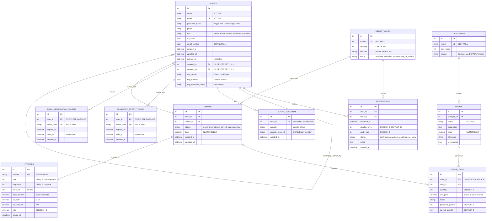

# RestoAPI · Diagrama entidad-relación final

Diagrama ER del plan del proyecto (§3.3) actualizado al final de P3, con las tablas tal como
están en los modelos SQLAlchemy de `app/models/` y las migraciones de Alembic hasta la `0010`
(`migrations/versions/`). Imagen exportada: [`er-diagram.png`](er-diagram.png).

## Cambios respecto al plan

El plan tenía 9 tablas; el modelo final tiene **11**: se quita `roles` y se añaden tres
tablas de autenticación.

| Tabla | Plan (§3.1) | Final | Motivo |
|---|---|---|---|
| `roles` | Tabla propia, con `users.role_id` → `roles.id` | No existe. El rol es la columna `users.role` y sus valores salen del enum `Role` (`app/models/model_user.py`) | Los roles son fijos: un enum es más simple y no necesita sembrar la tabla. Ahora son 5: se añadió `bartender` para la barra (HU-40) |
| `users` | `role_id` → `roles.id` y sin las columnas de seguridad ni de auditoría | `role` en vez de `role_id`; `password_hash` admite `NULL`; columnas nuevas `email_verified`, `updated_at`, `deleted_at`, `created_by`, `updated_by`, `totp_secret`, `totp_enabled` y `totp_recovery_codes` | Soft delete y auditoría (HU-32), cuentas solo con login social (HU-38), verificación de email (HU-33) y verificación en dos pasos (HU-37) |
| `social_accounts` | No estaba | Nueva (HU-38) | Vincula un usuario con su cuenta de Google o GitHub. `UNIQUE (provider, provider_user_id)` |
| `password_reset_tokens` | No estaba | Nueva (HU-52) | Enlace de un solo uso para crear o recuperar la contraseña. Solo se guarda el hash del token |
| `email_verification_tokens` | No estaba | Nueva (HU-33) | Enlace de un solo uso para verificar el email. Solo se guarda el hash del token |
| `categories` | Sin `station` | Añade `station` (`kitchen` o `bar`, por defecto `kitchen`) | Decide a qué rol llega cada línea de un pedido (R-14). Sin `CHECK` en la BD: los valores se validan en la API |
| `order_items` | Sin unidades preparadas ni servidas | Añade `prepared_quantity` y `served_quantity` (por defecto 0) | Unidades ya preparadas y ya servidas de cada línea (tarea #117) |
| `invoices` | `subtotal`, `tax`, `payment_method` | `base_amount`, `tax_rate`, `tax_amount`, `year`, `sequence`; sin `payment_method` | Nombres más claros, IVA guardado por si cambia el tipo, numeración que se reinicia cada año (`UNIQUE (year, sequence)`). El método de pago no entró en la HU-14 |
| `orders` | `table_id` y `waiter_id` obligatorios en la relación | Admiten `NULL` | Así quedó el modelo de pedidos; el camarero se guarda al crear el pedido (HU-05) |
| `orders` → `order_items` | Al menos una línea (`\|\|--\|{`) | Puede no tener líneas (`\|\|--o{`) | La API no exige un mínimo de líneas al crear el pedido |
| `dishes` | `price CHECK ≥ 0` | Sin `CHECK` en la BD | La validación de precio está en la API |
| `orders.status` | Valores fijos | Sin `CHECK` en la BD | Los valores se validan en la API (`Literal` en el esquema) |

`dining_tables`, `reservations` y las columnas del plan de `categories` y `order_items` siguen
el plan, con `CHECK` en la BD para `capacity`, `location`, los `status` de mesas y reservas,
`party_size`, `duration_min` y `quantity`.

## Migraciones (Alembic)

El esquema se gestiona con migraciones de Alembic (HU-23), una por cambio de modelo, en
`migrations/versions/`. El CI comprueba que hay una sola cabeza y que las migraciones dan el
mismo esquema que los modelos (`tests/test_migrations.py`). Cómo aplicarlas, y qué hacer con
las BD creadas antes de Alembic, está en [`deploy.md`](deploy.md) (sección 8).

| Migración | Qué cambia | Origen |
|---|---|---|
| `0001_esquema_inicial` | Crea las 8 tablas de P2 | HU-23 |
| `0002_platos_preparados_y_servidos` | `order_items.prepared` y `order_items.served` (booleanos) | P3 |
| `0003_station_en_categorias` | `categories.station` | HU-06 |
| `0004_soft_delete_y_auditoria_usuarios` | `users.updated_at`, `deleted_at`, `created_by`, `updated_by` | HU-32 |
| `0005_login_social` | Tabla `social_accounts`; `users.password_hash` pasa a admitir `NULL` | HU-38 |
| `0006_unidades_preparadas_y_servidas` | Cambia `prepared` y `served` por `prepared_quantity` y `served_quantity` | Tarea #117 |
| `0007_barra_bebidas_y_postres` | Solo datos: las categorías `Bebidas` y `Postres` pasan a `bar` | HU-40 |
| `0008_tokens_para_crear_contrasena` | Tabla `password_reset_tokens` | HU-52 |
| `0009_verificacion_email` | `users.email_verified` (las cuentas existentes quedan verificadas) y tabla `email_verification_tokens` | HU-33 |
| `0010_verificacion_en_dos_pasos` | `users.totp_secret`, `totp_enabled` y `totp_recovery_codes` | HU-37 |

`app/main.py` todavía llama a `Base.metadata.create_all` al arrancar. Solo crea las tablas que
faltan y no modifica las existentes, así que cualquier cambio en una tabla ya creada necesita su
migración.

## Notas

- **`dining_tables`:** se llama así porque `table` es palabra reservada de SQL.
- **Precio histórico:** `order_items.unit_price` guarda el precio del plato al crear la línea.
  Si después cambia `dishes.price`, los pedidos, las facturas y las estadísticas no cambian.
- **Estación de una línea (R-14):** no se guarda en `order_items`. Se deriva al responder de la
  `station` de la categoría de su plato (`order_items.dish_id` → `dishes.category_id`).
- **Progreso del pedido (HU-45, R-16):** no tiene columna ni tabla. `ready_to_serve`, `stage` y
  `by_station` se calculan al responder con `quantity`, `prepared_quantity` y `served_quantity`.
- **Estadísticas (HU-15):** no tienen tabla propia. Se calculan sobre `orders` y `order_items`
  (pedidos `served` y `paid`) y se guardan en una caché en memoria.
- **Límite de intentos de login (HU-31, R-10):** tampoco usa tablas. Los contadores están en
  memoria y se pierden al reiniciar la API.
- **Secretos de seguridad (HU-37, HU-33, HU-52):** `users.totp_secret` se guarda cifrado con
  Fernet, los códigos de recuperación y los tokens de las dos tablas de tokens solo como hash.
  Nunca se guarda el valor original.
- **Borrado de usuarios (R-04):** un usuario nunca se borra físicamente. Las FK de
  `social_accounts` y de las dos tablas de tokens llevan `ON DELETE CASCADE` por si se limpia la
  BD a mano, y `created_by` y `updated_by` llevan `ON DELETE SET NULL`.
- **Regenerar la imagen** si cambia el modelo: pegar el bloque Mermaid en
  [mermaid.live](https://mermaid.live), exportar como PNG y guardarlo en `docs/er-diagram.png`.
